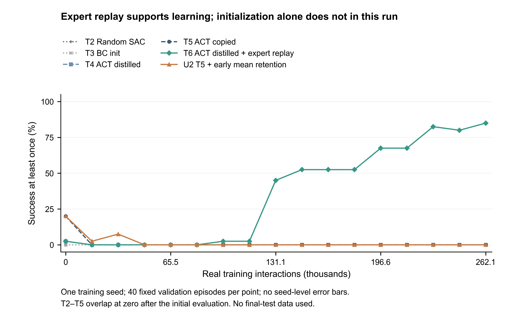
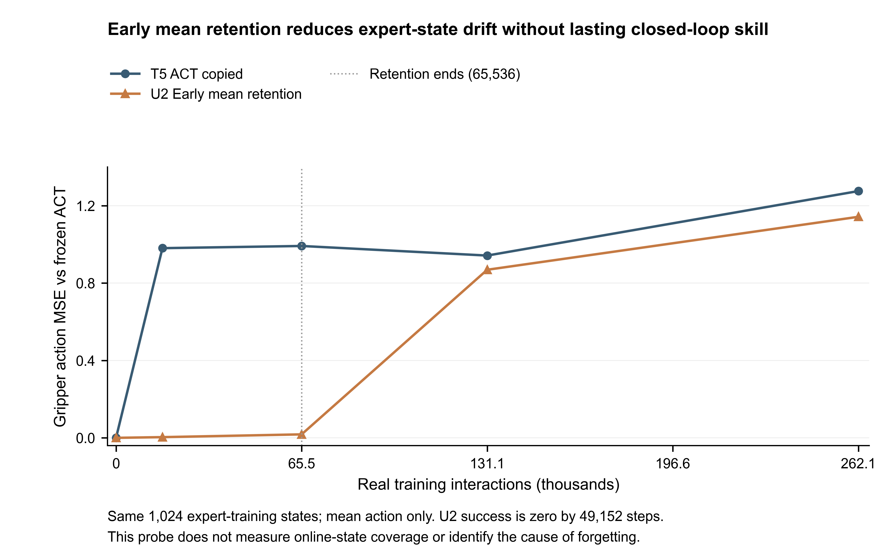

# U2 完整开发运行验收（2026-10-19）

U2 已完成；归类 **B：专家分布均值漂移减小，但没有持续闭环收益**。这是固定开发 seed0 的有限负结果，不能外推为所有保持机制无效。正式106条件评测正在原预算内执行，下面仅使用开发/验证和训练数据，不用测试结果调整方法。

## 固定协议与单因素审计

T5/U2 都是262144训练交互、64528更新、136000验证交互、17×40回合、相同初始Actor和双LN Critic。U2仅增加λ=10×max(0,1−t/65536)的专家训练状态首动作均值MSE；15360次有效辅助更新、983040个标签样本，截止后零采样。教师标签预计算且来源哈希验证，最终Actor独立部署。训练result中的frozen_il_verified=false表示旧在线IL模块未构造，不能误读为预计算ACT标签被训练更新；教师不变由独立审计保证。

权威审计：`artifacts/act-u2-comparison-audit-001/`；本轮复算：`artifacts/act-u2-final-review-cpu-001/analysis/result.json`，含原文件SHA256、指标原值、实际回放分段和成本。逐回合原记录仍在各训练目录。

## 闭环阶段结果

|方法|交互步|成功一次/40|末步成功/40|抓取/40|放置/40|平均回报|
|---|---:|---:|---:|---:|---:|---:|
|T5|0|8|4|28|8|12.300|
|T5|16384|0|0|0|0|0.000|
|T5|65536|0|0|0|0|0.000|
|T5|131072|0|0|0|0|0.000|
|T5|262144|0|0|0|0|0.000|
|U2|0|8|4|28|8|12.300|
|U2|16384|1|1|14|1|0.850|
|U2|65536|0|0|0|0|0.000|
|U2|131072|0|0|0|0|0.000|
|U2|262144|0|0|0|0|0.000|

U2的32768点另有3/40成功、31/40抓取；49152起所有14个验证点成功和抓取均0。退化发生在约束结束之前，不能归为“65536结束后才遗忘”的纯情况C。初期抓取部分保留，但未稳定保持初始技能。

**测量缺口**：在线验证未保存抬升高度或完整轨迹，也未保存首次抓取时间；无法从抓取/放置标记准确倒推。相关字段为null，不填0。初始C1的独立闭环轨迹与教师评测有更细阶段记录，但不能替代在线各阶段的缺失测量。以后新批次需预登记该记录。

## 均值、方差、Critic与真实奖励

固定1024个expert-train状态，U2夹爪对教师MSE在16384/65536/131072/final为0.003594/0.017949/0.868805/1.142592；T5在16384为0.980480。U2确实约束了这组状态的均值，但它没有约束log_std：U2四维均值log_std在16384约−0.70/−0.70/−0.74/−0.60，65536约−0.40/−0.43/−0.40/+0.24，显著偏离初始−2。真实执行动作的方差见原始分段数组；不能把跨状态动作离散程度当作条件策略熵。

U2全部262144训练转移只有6条正奖励，首次出现在完成231312次交互的向量步，来自1个episode；保持期内0正奖励。T5全程0条。晚期偶发正奖励未转化为验证技能。T6有63147条，首次100528交互；T4为0。保存的逐转移计数包括16个未完成episode尾段，与完整回合分母分开。

U2日志Q1/Q2峰值约56.20，final约0.279/0.277；alpha final3.93e−6；Actor loss final−0.279。精确五阶段alpha、Q1/Q2、TD MSE、Actor loss与前后窗口范围保存在复算JSON。Soft Q含熵，不能凭量级宣称任务价值高估；当前没有MC校准证据。有限标量值也不能证明Critic指导正确。

## 当前动作映射的真实梯度

`scripts/diagnose_act_mapping_gradients.py`在同一1024个真实训练状态和T5/U2五阶段检查实际forward/get_action。初始夹爪99.0234%的原始输出超出裁剪边界；这些元素的pre-tanh均值、确定性动作、采样动作和log-prob对原始动作头输出的均值路径导数均为0。未裁剪维度导数可通过；共享Transformer仍可通过其他动作维度和方差分支变化。

U2在16384/65536的夹爪裁剪比例为87.2070%/79.1992%，T5在这些点为0；final U2该维度为0。裁剪导致初始边界动作无法直接通过该维均值路径优化，是实际限制；它并不证明在线失败的唯一原因，也不能将初始低MSE全归因于保持正则。T5同样初始饱和却迅速漂移，说明饱和并不冻结整个网络。

CPU001的严格float32恒等导数容差失败（最大差4.59e−5），保留日志。CPU002同时记录实际float32误差、验证未裁剪正导数及float64解析恒等式，全部通过；U2实测最大误差7.55e−5。没有改网络、优化器或训练权重。原始逐状态/维度导数与模型前后不变验证见`artifacts/act-mapping-gradient-cpu-002/analysis/`。

## 资源和结论边界

T5/U2整GPU作业分别3743.462/3735.248秒，峰值5769/5770MiB；这些作业时间含17次验证，未单独记录每次验证GPU时间，不伪造拆分。CPU诊断新增环境交互0、优化更新0。

证据链：F-ACT-02 → 早期策略退化 → IBRL/RFT和遗忘保持文献 → 单一有限均值约束 → T5/U2配对初始条件完整对照 → 固定末次同为0/40 → 有界关闭此假设。未扩大λ搜索，不加入第三机制。方差、真实状态覆盖、Critic与warmup仍为竞争解释。

## 可复算图

两图使用全部已记录开发点，不使用正式测试；一训练seed不绘制伪造的seed误差带。CSV、来源哈希、PDF/SVG/PNG与绘图脚本一并保存。文字/碰撞审计和逐图目视检查见artifacts/act-development-figure-qa-001。
